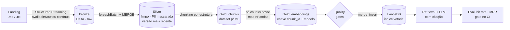

# 🔎 RAG Data Platform: LGPD

[](https://github.com/nielknauan/rag-data-platform/actions/workflows/ci.yml)


Plataforma de dados para **RAG (Retrieval-Augmented Generation)** sobre a **LGPD** e políticas internas de privacidade. O foco é a **engenharia de dados por trás do RAG**: ingestão batch e streaming, dataset de chunks pronto para ML, **pipeline de embeddings incremental**, **indexação vetorial**, governança de PII e avaliação contínua da qualidade da busca.

> Pergunta: *"O que fazer em caso de vazamento de dados?"*
> Resposta com fonte: **LGPD, Art. 48** + **Política interna ACME, seção "Incidentes de segurança"**

---

## 🏛️ Arquitetura



## ✅ Requisitos de Engenharia de Dados para IA → onde estão no projeto

| Requisito | Implementação |
|---|---|
| **Ingestão batch e streaming** | `ingestion.py`: o mesmo código Structured Streaming roda em batch (`trigger(availableNow=True)`) ou contínuo (`make stream`). Checkpoints garantem exactly-once |
| **Data lake / warehouse** | Medalhão em Delta Lake: Bronze (raw, append-only) → Silver (MERGE, versão mais recente por documento) → Gold (chunks + embeddings) |
| **Datasets otimizados para ML** | `gold/chunks`: chunking orientado à estrutura. Artigo curto vira 1 chunk; artigo longo vira **1 chunk por inciso com o caput repetido**, para que cada definição tenha seu próprio vetor. Markdown é quebrado por seção. IDs determinísticos, contagem de tokens e metadados para filtro e citação |
| **Pipeline de embeddings** | `gold.py`: embeddings distribuídos via `mapInPandas`, modelo carregado uma vez por worker, modelo multilíngue rodando em CPU (ONNX) |
| **Indexação vetorial para RAG** | `vector_index.py`: LanceDB com `merge_insert` incremental (insere, atualiza e remove vetores órfãos), filtro por metadados, ANN (IVF-PQ) automático acima de 5 mil vetores e **busca híbrida**: vetor + BM25 em português (stemming e stopwords), fundidos por Reciprocal Rank Fusion |
| **Qualidade, governança e segurança** | PII (e-mail, CPF, CNPJ, telefone) mascarada **antes** do embedding; quality gates bloqueiam publicação se houver PII, chunk vazio ou grande demais, vetor faltando ou dimensão inconsistente; contagem de PII mascarada auditável na Silver |
| **Custo de storage e processamento** | Hash de conteúdo + chave `(chunk_id, modelo)`: reprocessar sem mudança gera **0 chamadas ao modelo**, o que é verificado no CI. Silver só reescreve documento quando o hash muda. `make maintain` roda OPTIMIZE e VACUUM |
| **Feature store com AI Engineers** | `gold/embeddings` funciona como feature store de vetores: versionada por modelo (vários modelos convivem, com rollback fácil), point-in-time via Delta time travel, e o índice é um derivado reconstruível |

## 📊 Avaliação contínua do retrieval

`data/eval/golden.jsonl` tem perguntas reais com o trecho esperado. O CI calcula **hit rate@5** e **MRR** para a busca **vetorial pura** e para a **híbrida**, e quebra o build se a qualidade cair (por exemplo, numa troca de modelo, chunking ou limpeza).

**Resultado no CI** (modelo `paraphrase-multilingual-MiniLM-L12-v2`, CPU):

| Versão | hit rate@5 | MRR@5 |
|---|---|---|
| v1: vetorial, 1 chunk por artigo | 0.895 | 0.750 |
| v2: vetorial, chunk por inciso | 0.842 | 0.842 |
| **v3: híbrida (vetor + BM25) + chunk por inciso** | **0.947** | **0.868** |

O golden set tem 19 perguntas. Reprocessar sem mudança gera **0 embeddings**: 62 de 62 chunks são reaproveitados. Quando chega um documento novo, só os chunks dele são embedados: 4 novos e 62 reaproveitados.

> **Caso real que motivou a v3:** "Quem é o encarregado de dados?" não achava o Art. 5º. O artigo tem 10 definições num chunk só, e o vetor ficava diluído. Quebrar por inciso melhorou a ordenação (MRR) mas, sozinho, derrubou o hit rate. Somar o BM25, que acha o termo exato, resolveu os dois. Hoje o Art. 5 vem em 1º lugar.

```bash
make eval
```

## 🧪 O que o CI prova a cada push

1. Testes unitários (PII, chunking, índice incremental, métricas, transformações Spark)
2. Carga completa landing → índice vetorial
3. **Gate de qualidade do retrieval** (hit rate@5 ≥ 0.8)
4. **Gate de custo**: rodar de novo sem mudança → `--max-new-embeddings 0`
5. **Incremental**: chega um documento novo → só os chunks dele são embedados, e o eval inclui perguntas sobre ele
6. Manutenção Delta (OPTIMIZE + VACUUM) e build da imagem Docker

## 🚀 Como rodar

```bash
# Docker
docker build -t rag-lakehouse .
docker run --rm rag-lakehouse                                  # testes + pipeline + eval
docker run --rm rag-lakehouse make run ask Q="Quem é o encarregado?"

# Local (Python 3.12 + Java 17/21)
make install
make all
make ask Q="Posso usar dados pessoais para treinar modelos de IA?"
make incremental      # simula chegada de documento novo
make stream           # modo streaming: solte .md em lakehouse/landing/docs
```

**LLM plugável:** por padrão a resposta é extrativa (os trechos com citação), sem custo. Para gerar texto:

```bash
LLM_PROVIDER=ollama    make ask Q="..."   # local, grátis
LLM_PROVIDER=openai    OPENAI_API_KEY=...    make ask Q="..."
LLM_PROVIDER=anthropic ANTHROPIC_API_KEY=... make ask Q="..."
```

## 📁 Estrutura

```
src/rag_lakehouse/
├── ingestion.py     # Bronze/Silver com Structured Streaming + MERGE
├── text.py          # limpeza, mascaramento de PII, chunking (funções puras)
├── gold.py          # chunks + embeddings incrementais (mapInPandas)
├── embeddings.py    # fastembed (multilíngue) | hash (testes)
├── quality.py       # quality gates antes de publicar o índice
├── vector_index.py  # LanceDB: merge_insert, filtros, ANN
├── rag.py           # retrieval + LLM plugável com citação
├── evaluate.py      # hit rate@k, MRR
└── pipeline.py      # CLI: run | stream | ask | eval | maintain
data/sample/         # LGPD (texto oficial, domínio público) + políticas fictícias
data/eval/           # golden set
```

## 🔄 No Databricks

Bronze e Silver usam Structured Streaming + Delta puro, então o código porta direto, trocando a fonte `text` por Auto Loader (`cloudFiles`) e os caminhos por tabelas do Unity Catalog. O índice LanceDB pode ser trocado por **Mosaic AI Vector Search** com *Delta Sync* apontando para `gold.embeddings`.

---

**Fontes:** [Lei nº 13.709/2018 (LGPD)](https://www.planalto.gov.br/ccivil_03/_ato2015-2018/2018/lei/l13709.htm), texto oficial de domínio público (trechos). Os documentos da "ACME" são fictícios.
Autor: [Nielk Nauan](https://www.linkedin.com/in/nielknauan/)
